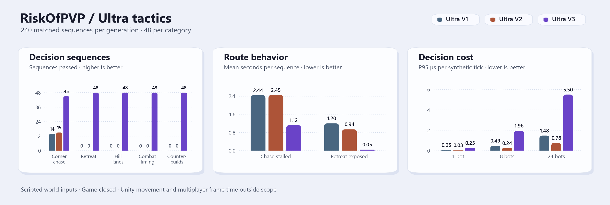
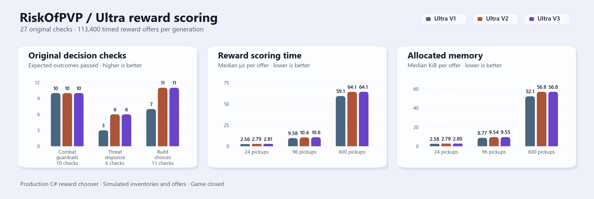

# RiskOfPVP

By **Clay Templar** and **MaTtHeBEST4444**.

Turn Risk of Rain 2 into a PvP arena. Fight everyone, split into red and blue teams, or compete over a moving capture point. Vote for a map, build your survivor with item rewards, and respawn to get back into the fight.

## Features

- **FFA, Teams and King of the Hill**, with separate settings for each mode.
- Map and mode voting before each match.
- **Command, Weighted, Draft and Random** item rewards.
- Adjustable starting rewards and rewards for kills, deaths or timed intervals.
- An XP choice instead of an item, with a level cap that rises over time.
- Global and survivor-specific item/equipment blacklists, stack limits and a reward scrapper.
- Survivor bots with five intelligence levels, configurable respawns, spawn protection, void rescue and anti-one-shot protection.
- DLC and custom item support through the game's catalogs.

Arena removes monsters, chests, shrines and teleporters. Void Fields, Void Locus and Planetarium have no void fog in Arena. The optional reward scrapper remains available. Normal gamemodes keep their usual rules.

## Getting started

1. Install the mod and its dependencies on every player's computer. Everyone needs the same version.
2. Launch modded and select **RiskOfArena**, next to Monsoon in character selection.
3. Use **Map Vote** and the mode buttons to vote. Open **Match settings** to set up the match, then ready up.

The Mod Options entry is **RiskOfPVP**. The in-game mode remains **RiskOfArena**. When upgrading, remove or disable older copies, including older RiskOfArena installations, and restart the game. Keep only one copy enabled.

One-person multiplayer lobbies work for practice or playing against bots.

## Modes

| Mode | Objective |
|---|---|
| **FFA** | Reach the kill goal before anyone else. |
| **Teams** | Red versus Blue, with shared kills and friendly fire disabled. |
| **King of the Hill** | Charge the Void Focus, then follow it to its next location. |

KOTH defaults to three captures to win. At the time limit, completed captures and then partial progress decide the winner. Capture goal, charge time, radius and relocation time are configurable.

At match end, **Continue** keeps builds and scores and extends the goal. **Play Again** starts a fresh match on the same map and mode. Both need a majority of human players. **Back to Lobby** is host-only.

## Items and leveling

| Reward mode | How it works |
|---|---|
| **Command** | Choose an essence, then a pickup from it. |
| **Weighted** | Roll an essence using the rarity weights, then choose its pickup. |
| **Draft** | Choose from a fixed set of pickups inside each essence. |
| **Random** | Receive a pickup automatically using the same rarity weights as Weighted. |

Draft choices are per essence: a setting of four gives four pickups in each class, where enough eligible pickups exist. Draft includes every enabled essence and does not use the Random/Weighted rarity roll.

Choice modes can offer **+1 Level** instead of an item. The host sets how the level cap grows. Personal levels have their own icon in the inventory bar and Tab display. Random alone can level everyone at a shared interval, every 60 seconds by default.

Rewards show the usual pickup notification. Falling into the void never grants death or kill rewards. Item selectors show icons and full descriptions, and respect enabled DLCs, host bans and each player's stack limits.

## Reward scrapper

The optional Arena scrapper has a marker and an outline visible through walls. Scrap items or equipment for reward points. Weighted, Draft and Random preserve the scrapped pickup's rarity or equipment class; Command keeps unrestricted choices. Item-removal effects still apply.

## AI bots

Set a starting bot count in Match settings, or use **Esc > Arena bots** during a match. Bot controls are host-only. Bots earn rewards, respawn, join balanced teams and choose builds in choice modes. All tiers use safe navigation and prioritize holding the KOTH zone. Inspect their inventories on the normal inventory scoreboard, usually **Tab**. Available survivors depend on registered survivor AI.

Bot intelligence is under **General > Bots**:

| Level | Behaviour |
|---|---|
| **Low** | Simple targeting, slower aim and fixed builds. |
| **Medium** | Standard tactics and fixed builds; the default. |
| **High** | Nearest-enemy awareness, including opposing summons, with fixed builds. |
| **Extra High** | Adaptive builds, predictive aiming, dodging, combat jumps and sprint resets. |
| **Ultra** | Tracks opponents across the map, plans routes and isolates firing angles in group fights. Learns skill damage, range, proc values and opponents' habits. |

**Chase mode** makes FFA bots prioritize humans. Teams and KOTH ignore it. **Decision interval** controls how often each bot plans, with a 0.05-second minimum and a 0.1-second default. **Decisions per tick** caps how many tactical passes each ready bot gets on that physics tick. It ranges from one to three, defaults to two, and uses spare time in the shared CPU budget for additional route and firing position checks. Combat input still runs on physics ticks between tactical batches. These host settings apply live. Bot reward choices follow the same offers, blacklists and limits as player choices. Fixed builds avoid buying a void item that destroys their existing setup. Adaptive builds consider conversion costs and can bank unsuitable offers.

Extra High and Ultra sprint when movement and their current skill allow it. Ultra checks line of sight before firing and dodges visible attacks or incoming projectiles with normal movement inputs. It reads its equipped skills and uses native AI for complex traversal, scope/reload, and custom survivor chains. Its builds use the normal reward pool, including eligible DLC items and equipment. [Bot build and combat rules](BOT_BUILDS.md)

Ultra keeps aiming and using available attacks while burst abilities recharge. It combines registered skill configuration with observed casts, attack parameters and hit outcomes. It can fire alongside skills on independent state machines; shared-state charges and animations still finish normally. Opponents' movement, accuracy and skill use gradually change its reaction, aim and evasive behaviour. It uses active threats and recovery windows to seek cover or push, and learns defensive priorities across respawns. Unknown custom skill behaviour uses estimates until observed; this is a bounded tactical model, not a simulation of every mod script. Bots receive the same rewards and follow the same item limits as players.

### Ultra benchmarks

These figures record the earlier comparison through commit `bece477`, before the 1.3.3 pressure and survival changes. They are offline tests, not player win rates or live frame-time measurements.

**Ultra V1** is the bot from v1.3.1, **Ultra V2** is from v1.3.2, and **Ultra V3** is the newest generation in this comparison.

#### Tactics

#### Reward scoring

All three ran the same scripted cases and scored the same synthetic offers. The game stayed closed. Live performance and win rates remain unmeasured. [Method and raw results](benchmarks/README.md#tactical-sequences)

## Settings and controls

Use **Match settings** in character selection or **Settings > Mod Options > RiskOfPVP**.

| Tab | Settings |
|---|---|
| **General** | Lobby maps, shared combat/respawn rules, protections, blacklists, pickup classes and bot behaviour. |
| **FFA / Teams / KOTH** | Each mode's rewards, scrapper, levelling, match limits and starting bot count. KOTH also has capture settings. |
| **Controls** | Your own keybinds, nametags, arrows and automatic reward-menu preference. |

Reward amounts use sliders: **0 turns the event off**. One-shot grace ranges from 0.25 to 2 seconds in 0.05-second steps. Void protection returns players to safe ground instead of killing them; fall damage has its own toggle.

The global blacklist includes equipment. Left-click a pickup to switch it On/Off. Right-click adds or increases a held-stack limit; Shift + right-click reduces it. For survivor-specific rules, choose the survivor first, then edit its pickups. Global bans and the stricter stack limit take priority. **Apply** saves; **Back** returns without applying unsaved changes.

Gameplay rules come from the host. Clients can view them but cannot edit them. Personal controls stay local. Combat, protection, pickup restrictions, bot behaviour and the scrapper toggle update live; reward clocks, levelling and eligible pickup classes apply next match.

On upgrade, shared rules inherit the previous default mode. Old mode blacklists merge into General with hard bans and stricter limits taking priority. Each mode keeps its own reward amounts and local controls stay unchanged.

| Default control | Action |
|---|---|
| **F2** | Open or close rewards |
| **F3** | Arena scoreboard |
| **F4** | Map vote |
| **Double-tap W** | Close the item or essence menu and bank the reward |

Double-tap W requires two presses and releases. Holding W when a menu opens will not dismiss it. **Back** also banks rewards. Reopening a menu does not reroll them.

## Compatibility and notes

RiskOfOptions and R2API Teams are required and included in the dependency list. Aerolt, DropIn, LookingGlass and larger-lobby mods are optional. DropIn supplies mid-game joining; Arena supplies catch-up rewards and team balancing. Teams and KOTH support expanded rosters; FFA has a finite combat-team limit.

In Arena, Aerolt 4.3.1 initializes its menu only after you press its configured menu key. Aerolt handles its own initialization; Arena does not load its DLLs or modify UniverseLib. Aerolt's native first-time initialization can still pause when you open the menu. Other gamemodes retain normal Aerolt startup. DropIn integration was checked against DropinMultiplayer 4.2.1. Custom items need valid catalog entries; custom tier behavior can vary. Mods replacing teams, respawns or progression may need compatibility work. Split-screen reward selection is not supported.

Built against Risk of Rain 2 **1.5.0#1224**. Automated checks pass. The new bot navigation, survivor-specific AI behaviour and large-lobby combinations still need fresh multiplayer testing.

MIT license.

[Building from source](BUILDING.md)
